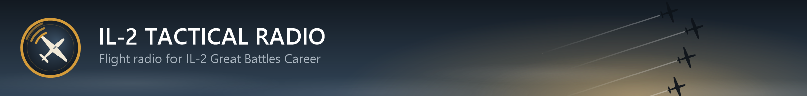

# IL-2 Tactical Radio



**[Download the latest release](https://github.com/kylebloom/AI_Friendly_Radio/releases/latest)**: the installer or a portable zip, then follow the [player guide](README-PLAYER.md).

A companion app for IL-2 Sturmovik: Great Battles single-player Career Mode. It adds a few realistic radio requests, such as asking friendly aircraft for their positions. It runs outside the game and only reads data IL-2 already exports, so it works with Mods Off and doesn't touch game files or the game process.

**Current milestone:** a proof of concept to find out what IL-2 actually exposes. Read [docs/FEASIBILITY.md](docs/FEASIBILITY.md) first. In short: aircraft identities, flights and statuses are available live. AI positions are only available at discrete events. Continuous positions come from IL-2's memory (read-only, since 2026-10-27; [docs/MEMORY.md](docs/MEMORY.md)), with IL-2's Tacview export as the fallback.

## How to run it
This is the one supported way to fly with the radio. You don't need anything else in this README to use it; the rest is reference.

**Once, before the first flight**
1. Get `Il2Radio.exe`. Players can take the installer or portable zip from [Releases](https://github.com/kylebloom/AI_Friendly_Radio/releases) and follow [README-PLAYER.md](README-PLAYER.md), the guide shipped with them. To build it yourself, install the [.NET 10 SDK](https://dotnet.microsoft.com/download/dotnet/10.0) and run this in this folder:
   ```bash
   dotnet publish src/Il2Radio.App
   ```
   This writes one self-contained `publish\Il2Radio.exe` (about 50 MB), which runs without .NET installed. Put it in a folder of its own, for example `C:\Games\IL-2 Radio\`. Its settings and session logs go next to it.
   The radio text, its menu and the kneeboard are drawn inside IL-2's own picture, fullscreen too, by the radio's own overlay (chat output `ingame`, [details](#radio-text-chat)). Nothing else needs installing.

**Every flight**
1. Double-click `Il2Radio.exe` and accept the administrator prompt. Positions from IL-2's memory don't need administrator rights; the track-recording fallback does, to read the file IL-2 keeps locked. A window opens; leave it open while you fly.
   - The Status tab checks that it runs as administrator and that IL-2 exports its mission log and Tacview tracks. Each check is `[ok]` or `[!!]` with what to do; problems are also shown in game at the start of each mission.
   - **On the first start**, if IL-2 is closed and isn't exporting that data yet, it asks whether to switch it on in `startup.cfg` (Yes; the file is backed up first). If IL-2 is running, close it and start the radio again.
2. Start IL-2 and fly a Career mission. The radio reads where everyone is straight from IL-2's memory (read-only; see [Live positions](#live-positions)), so no track recording is needed. If memory can't be read, it falls back to the track: press **LCtrl+R** in the cockpit to record one, and the radio reminds you in game if neither is available a minute into the mission.
3. With Num Lock on, use the numpad:

   | Key | Does |
   |---|---|
   | Numpad 1 | Ask all friendlies for their positions |
   | Numpad 2 | Ask your flight where it is |
   | Numpad 3 | Separated: ask your flight to help you rejoin |
   | Numpad 4 | Ask your flight what enemy or unknown aircraft it can see |
   | Numpad 5 | Ask your flight to identify the nearest aircraft it can see |
   | Numpad 0 | Open the radio menu in game (choose with Numpad 1–5). Flight › also has *Where am I on the route*, *Steer home* and *Steer to target*; Kneeboard › has *Fix position by a landmark* and the sheet's size. They have no key of their own unless you set one (`keys.routePosition`, `keys.steerHome`, `keys.steerTarget`, `keys.fixPosition`) |
   | Numpad / | The [kneeboard](#kneeboard): small, then large, then put away |
   | Numpad 7 / 9 | Page back / forward through earlier radio messages |
   | Numpad . | Quit (also writes a session report to `logs\` next to the program) |

   The Help tab in the radio window explains what the program is for and when to use each call, for whichever air force you are flying. The keys shown there are the ones on the Settings tab.

   Closing the window, or Quit, also quits cleanly.

### Settings
The first start creates `settings.json` next to `Il2Radio.exe` with every setting at its default. Change them on the Settings tab and choose Save and apply. The volume takes effect on the next transmission; anything else restarts the radio in the same window. A bad value is reported by name and nothing is restarted until it is fixed. Reset to defaults puts the form back; it is saved only when you apply. The file can still be edited by hand (delete it to get the defaults back).

| Setting | Default | Meaning |
|---|---|---|
| `il2Path` | `null` | IL-2 folder (the one with `data\startup.cfg`). `null` looks in `IL2_PATH` and the usual Steam folders |
| `volume` | `0.8` | Radio volume, 0 to 1, independent of IL-2's own |
| `voice` | `"auto"` | `auto`: the game's pilot voices by nation; words they have no recording for stay on the radio text. `off`: radio text only (the key click still plays). Or a voice pack's name or folder. Windows text-to-speech was removed on 2026-10-26, so `tts` is reported as an error |
| `realism` | `"pilot"` | `pilot`: a friendly says only what that pilot could know (below). `precise`: bearings and ranges from the live track |
| `positions` | `"auto"` | Where live positions come from. `auto`: IL-2's memory, and the track recording when memory can't be read. `memory`: memory only. `track`: the track recording only (LCtrl+R, administrator rights), as before 2026-10-27 |
| `unasked.route` | `true` | On a cruise leg, one course call per turn, the new heading to the nearest 5°. The chat says "Number one, turning to heading 180" once an AI leader starts the turn at a corner, and "Number one, heading 180" once he is already on it. The headset says his callsign and number, "turning left" or "turning right" for a corner ahead, and the compass point ("south"); the degrees stay on the chat. When you are the leader, the chat shows "Route, turning to heading 180" and the headset stays quiet. Off once you leave the briefed route, except a gentle turn by an AI leader. Also: an AI leader turning 45° off his course says "turning left. Follow me." while he is still flying and someone in the flight is within 4 km ("engaging, turning left" when an enemy within 15 km of him is in the picture, or when his turn points him at an enemy aircraft). A turn once he has left the others, or on the ground, stays quiet. A mate who can see you running ahead of the flight says "you are a few kilometres ahead of us. Slow down and rejoin." If they lose sight of you out in front, and you are not far, the leader says so with his heading and altitude |
| `unasked.contacts` | `true` | One call when the contact picture changes: a group gained, lost, or "on me". The same sentence as Numpad 4. A clock that merely slides is left unsaid, the same aircraft are not called again within a minute (unless one comes onto a pilot or lets go of him), and picture calls are at least 15 s apart except a new "on me" |
| `unasked.losses` | `true` | A flight mate who saw it calls a loss on the chat: "Lumme six is down. Hurricane down." An enemy going down is also "target destroyed" in his voice; a mate's loss has no recording, so it is text only. Left to the game's own pilots: their own kills, yours, and a mate shot down who can still call that he is hit |
| `radioWait`, `radioWaitRatio` | `true`, `1.8` | Hold replies while IL-2's own radio is talking ([details](#audio)) |
| `recordingReminderSeconds` | `60` | Remind you to press LCtrl+R this long into a mission with neither memory positions nor a track; `0` never |
| `chat.output` | `"ingame"` | `ingame` (drawn in IL-2's own frames by the radio's overlay; works in fullscreen; the only output with the kneeboard), `overlay` (windowed IL-2 only), `window` (e.g. a second screen) or `off`. The RTSS output was removed on 2026-10-28: `rtss` is reported as an error, and the old `chat.rtss*` settings are accepted and dropped |
| `chat.screen`, `chat.windowArea`, `chat.fontPixels` | `0`, `[0.015, 0.40, 0.42, 0.30]`, `16` | Overlay/window: screen number, area (left, top, width, height as screen fractions), font size on a 1080-line screen |
| `chat.keepClear` | `true` | Keep the text out of IL-2's own message line and subtitles |
| `kneeboard.view` | `"small"` | The kneeboard's view at the start of a flight: `hidden`, `small` or `large`. The kneeboard key writes the view you leave it in back here |
| `kneeboard.position` | `"centre-right"` | `centre-right`, `top-right`, `bottom-right`, `top-left`, `bottom-left`, `centre-left` (that corner, or the middle of that side, pinned a margin of 2 % of the screen height in), or `custom` |
| `kneeboard.custom`, `kneeboard.customScreen` | `null`, `null` | With `custom`: `[x, y]`, the sheet's top-left pixel of IL-2's picture, and the `[width, height]` IL-2 ran at when it was set (the Settings tab fills it from `startup.cfg`), so it scales with the resolution. The sheet is always kept on screen |
| `keys.*` | `Num1` … `Num.` | One key per action: `friendlyPositions`, `flightPosition`, `rejoin`, `enemyContacts`, `identifyContact`, `routePosition`, `steerHome`, `steerTarget`, `fixPosition` (these four unbound by default; they are in the radio menu), `kneeboard` (`Num/`), `menu`, `older`, `newer`, `quit`. Names: `Num0`–`Num9`, `Num.`, `Num+`, `Num-`, `Num*`, `Num/`, `F1`–`F24`, `A`–`Z`, `0`–`9`, `Insert`, `Delete`, `Home`, `End`, `PageUp`, `PageDown`, arrows, `Pause`, `ScrollLock`. `""` leaves an action unbound |

Keys are watched, not taken: IL-2 still receives them, so pick keys IL-2 doesn't use. The options are described in more detail under [Radio text](#radio-text-chat), where they appear as `live` flags of the diagnostic console.

## Layout
- `src/Il2Radio.Core`: decoders (binary/text mission log, UDP telemetry, ACMI, .Mission), `ContactTracker`, radio commands, visibility model, settings
- `src/Il2Radio.Windows`: Windows-only I/O (keys, audio, chat outputs, shadow copies) and the live session
- `src/Il2Radio.App`: the radio app, `Il2Radio.exe`
- `src/Il2Radio.Diag`: diagnostic console for development
- `voices`: voice-pack manifests (file names only; the game packs point into your IL-2 install). Built into both programs.
- `tests/Il2Radio.Core.Tests`: xUnit tests, including a real Career `.mlg` fixture

Docs:
- [docs/ARCHITECTURE.md](docs/ARCHITECTURE.md): how each subsystem works; start here before changing code.
- [docs/ROADMAP.md](docs/ROADMAP.md): what's left, and what still needs checking in a flight.
- [docs/FEASIBILITY.md](docs/FEASIBILITY.md): research and evidence, with sources.

## Build & test
```bash
dotnet test
```
Requires the .NET 10 SDK.

## Releases
The version is in `Directory.Build.props`; a release takes it from the tag instead. Push a tag such as `v0.2.0` and [.github/workflows/release.yml](.github/workflows/release.yml) tests, publishes, builds the installer ([installer/Il2Radio.iss](installer/Il2Radio.iss), Inno Setup 6) and a portable zip, and attaches both to a GitHub Release. Running the workflow by hand builds the same files as an artifact without releasing. To build the installer locally:
```bash
dotnet publish src/Il2Radio.App -p:Version=0.2.0
iscc installer\Il2Radio.iss /DAppVersion=0.2.0
```
Both files go to `publish\`. They aren't code-signed yet; the workflow and the installer script mark where signing goes.

## Diagnostic console
For development: the full monitor (every source, every contact, why each one stayed silent) and offline tools. It takes command-line flags instead of `settings.json`; for `live`, run the terminal as administrator.
```bash
dotnet run --project src/Il2Radio.Diag -- check            # which IL-2 outputs are enabled
dotnet run --project src/Il2Radio.Diag -- check --apply    # enable them (IL-2 must be closed; startup.cfg is backed up)
dotnet run --project src/Il2Radio.Diag -- mission          # planned Career mission (_gen.Mission)
dotnet run --project src/Il2Radio.Diag -- mlg              # decode newest data\FlightLogs\*.mlg
dotnet run --project src/Il2Radio.Diag -- acmi             # summarise newest data\Tracks\*.acmi
dotnet run --project src/Il2Radio.Diag -- snapshot-test    # time reading a locked file via Volume Shadow Copy (admin)
dotnet run --project src/Il2Radio.Diag -- live             # run while flying (see keys below)
```
Pass `--game <IL-2 root>` or set `IL2_PATH` if IL-2 isn't in the default Steam location.

`check --apply` sets these in `data\startup.cfg`:
| Section.key | Value | Purpose |
|---|---|---|
| `telemetrydevice.*` / `motiondevice.*` | enable, 127.0.0.1:29373 | player state and attitude (UDP) |
| `system.mission_text_log` | 1 | text mission log |
| `track_record.tacviewrecord` | 1 | Tacview ACMI while a track records |

The UDP telemetry port can only point to one listener. If you use SRS or a bass-shaker tool, they'll conflict for now (a relay is on the roadmap).

`live` writes `diag-output\evidence-*.md` and a raw UDP capture you can replay. Please share the evidence file after a test flight.

### Radio keys (Num Lock on; they work while IL-2 has focus)
| Key | Command | Example reply |
|---|---|---|
| Numpad 1 | Request friendly positions | "Oriole one, five aircraft together, at your three o'clock, far, level with you." |
| Numpad 2 | Request flight position | "Oriole one, flight of five, at your three o'clock, far, above you." |
| Numpad 3 | Separated, request rejoin | "Oriole one, at your four o'clock, far, above you. Heading east, altitude 2500 metres." |
| Numpad 4 | Request enemy contacts | "Oriole two, four Yaks, at your four o'clock, a few kilometres, high, heading west." |
| Numpad 5 | Identify nearest contact | "Oriole two, contact at your two o'clock, close: a Messerschmitt, enemy, heading east." |
| Numpad 0 | Open the radio menu: numpad digits choose an entry or open a submenu (they don't fire their own calls while it is open), Numpad 0 steps back and closes it at the top, Numpad . closes it | |
| Menu: Flight › 3 (or `keys.routePosition`) | Where am I on the route | "Oriole one, grid 1118-5, leg three of eight. Next waypoint, attack area, heading 095, 10 kilometres." |
| Menu: Flight › 4 (or `keys.steerHome`) | Steer home | "Oriole one, Tusov, heading 250, 19 kilometres." |
| Menu: Flight › 5 (or `keys.steerTarget`) | Steer to target | "Oriole one, target area, heading 155, 23 kilometres." |
| Numpad 7 / 9 | Page back / forward through the radio log (paging forward past the newest page returns to the live lines) | |
| Numpad . | Quit (writes the evidence file) | |

Aircraft within 2 km and 600 m of each other answer as one group through their lowest-numbered member. Only your own flight answers Numpad 2 and 3.

**Route and steers (radio menu, Flight ›)** answer what you would otherwise open the map (O) for: your map square (Stalingrad only), which leg of the briefed route you are on, and the next waypoint, home field or briefed attack area as a course to the nearest 5° and a distance in kilometres. Your AI leader answers when he is in formation with you or can see you (`pilot`; under `precise`, whenever he can hear you); when you lead, fly alone, or he cannot see you, it is your own reading of the map, on the chat as "[Route]" and not spoken. They are measured only from positions read from IL-2's memory, which are in the same map metres as the briefing. From a track recording alone the route call gives the square and nothing more, the steers give nothing, and the chat says "no steer: only IL-2's memory puts you on the briefing map". An escort with no attack area says "no target area in the briefing".

Those examples are `realism` `pilot`, the default. A pilot gives a position relative to you when he can see you, or when your own flight is in formation. Anyone who can hear the call but cannot see you answers with his own heading and altitude ("Oriole one, I cannot see you. Heading east, altitude 2500 metres.") and does not invent a clock position. He also names the map square he is in ("Grid 1022-5"), or the four digits alone when he is close to a line inside that square. Your own flight does that only while it is still on its briefed route; another friendly flight does it whenever it can hear you. Ranges are close, a few kilometres, or far. Set `realism` to `precise` for the earlier wording ("bearing one-one-zero, approximately 18 kilometres, altitude 2700 metres", and a steer on Numpad 3).

**Unasked calls** are on until you turn them off, each on its own, under `unasked` in `settings.json` or the two checkboxes on the Settings tab. On a cruise leg the chat says the new course once as the leader starts the turn at a corner, to the nearest 5° ("turning to heading 180"), and "heading 180" once he is already flying it, so you can follow an AI leader without the map. If he turns off his course, for the enemy or otherwise, he says "turning left. Follow me." while he is still with the flight and still flying, with "engaging" when that fight is his. A turn after he has left the others, or from the ground, stays quiet. If you run out in front of the flight, a mate who can see you tells you to slow down and rejoin, and if they lose sight of you, and you are not far, the leader says so and gives his heading and altitude. His own voice says his callsign and number; the degrees stay on the chat. When you are the leader, that line is labelled "Route" and nothing is spoken. In a fight you get one line when the picture changes, and then silence until it changes again. A numpad press still cuts whatever is waiting. While a track is recording, hearing these means reading the locked file about every 10 seconds; turning both off stops that.

**Contacts and identification (Numpad 4 and 5) aren't radar.** Your flight reports only what its pilots could plausibly see. Flying alone, any friendly in radio range reports instead. In `pilot`, that call is in your clock when the spotter is with you. A pilot in the fight who cannot see you says "four Yaks, on me." One who can see them but not you gives his own clock ("at my three o'clock, a few kilometres"). Up to four aircraft are counted once their shape is visible; otherwise the call is "a few" or "many". From the same range the shape is visible (about 4 km for a fighter), Numpad 4 also says which way the group is flying, on the eight compass points ("heading west"); a group fighting the pilot who reports it ("on me") gets none, and a "last seen" group keeps the direction it had when it was last seen.
- **Spotting:** likelier for larger aircraft and at closer range. Haze, darkness, a target below you against the ground, and cloud between observer and target all make it harder. It's a game-design model, not physiology.
- **What gets said:** depends on range. In order of getting closer, about four ranges apart for a fighter:
  - a speck: "unidentified aircraft"
  - its shape: "unidentified fighters"
  - its markings, side known (~3 km): "enemy fighters"
  - its type (~1.8 km): "Yaks"

  Bombers can be made out further away than fighters.
- **Uncertainty:** near the edge of identification range, a call can be hedged ("possible Yaks") or mistake a look-alike (Yak ↔ Messerschmitt), and a closer look corrects it.
- **Memory:** a spot is kept for 60 s after the aircraft leaves sight, including a pass that happened between calls. The reply says where it was last seen ("last seen at your three o'clock, close"), not where the track has moved it since. Identifications don't flicker, and they don't get sharper from a look the pilot no longer has.
- **Voices:** recorded game clips cover class words ("fighters", "bombers"), clock positions, ranges and high/low. The game has no recordings of type names or "no contacts": the class word stands in for the type, "no contacts" is the pilot's "Roger", and the type stays on screen.
- **Friendlies close by:** a pilot who has made out that the aircraft beside him are friendly says "with me", not "on me", which means an enemy is on him.

Pilots identify themselves by their Career callsign and number from the mission plan ("Oriole two"). The callsign words come from your install's `data\GUI\DefaultCallsigns.eng`. If a pilot isn't in the plan or the word is unknown, he says "Number two", or his name if he's from another unit.

### Audio
Replies are spoken by **IL-2's own radio voice actors** in the speaker's language: German for Luftwaffe (country 201), Russian for VVS (101), English for RAF and USAAF (102, 103). The app reads the recordings straight from your install (`data\Audio\radio\…\*.ogg`) and joins fragments such as number, clock position, range and high/low. Nothing is copied out of the game or modified. No setup is needed if IL-2 is in the default Steam folder; otherwise pass `--game <IL-2 root>` or set `IL2_PATH`.

The game's fragments are coarser than the English text, which still appears on screen. For example, "flight of five, at your three o'clock, far, above you" is spoken as *Oriole · one · group · three o'clock · long range · high*. Only the game's recordings are ever played, one pilot per transmission. A word they have no recording for is left out of the audio and stays on screen: "a few kilometres", "on me", "I cannot see you", "last seen", altitude, a map square, a type name, "enemy" and "possible". Where a whole message has no recording, a nearby game phrase stands in rather than silence:

| On screen | Spoken |
|---|---|
| "Lumme one, no contacts." | *Lumme* · *one* · *Roger* |
| "Lumme one, you are in formation with us." / "you are with us" | *Lumme* · *one* · *to the left* / *to the right* / *behind*, where he sits off your nose; *Roger* when he is ahead |
| "Lumme five, single unidentified aircraft, at my eleven o'clock, …" (unasked, a newly gained contact) | *Lumme* · *five* · *spotted* · … |
| "Number one, turning to heading 205." | *one* · *turning left* · *southwest* |
| "Number one, heading 180." | *one* · *south* |
| "Lumme five, Hurricane down." | *Lumme* · *five* · *target destroyed* |
| "a few Yaks" / "many" | *group* · *fighters* |
| "Lumme six is down." | nothing: no recording says a mate is down, so it is text only |

The placeholder meanings were read from the English actors' recordings of the same script with Windows speech recognition (Roger 0.70–0.90 confidence, turning left/right 0.61–0.74, target destroyed 0.61, spotted 0.78–0.85, to the left / to the right / behind 0.67–0.74). The German and Russian files are assumed to say the same; listen with `voice-check --country 201 --play`.

Every transmission then goes through a radio effect:
- squelch burst at the start, tail and click at the end
- 300–3000 Hz voice band with slight overdrive. The game's clips are already radio-processed, so they only get a gentle drive.
- background hiss that gets louder the further away the speaker is

Each flight number gets its own voice actor (four German and five Soviet pilot voices, reused beyond that). A new request cuts off any replies still waiting to be spoken.
```bash
dotnet run --project src/Il2Radio.Diag -- say                          # sample replies, German pilots
dotnet run --project src/Il2Radio.Diag -- say --country 101 --range 0.8 --volume 0.6   # Soviet pilots, further out
dotnet run --project src/Il2Radio.Diag -- voice-check --country 201 --play   # play every clip with its key
dotnet run --project src/Il2Radio.Diag -- live --volume 0.6            # or --voice off, or --no-audio
```
Volume is independent of IL-2's own sound settings.

**Not talking over IL-2's radio:** `live` watches the Windows peak meter of Il-2.exe's audio session (read-only, as the volume mixer does). A reply waits while IL-2's audio rises clearly above its engine floor (default 1.8×), for at most 8 s. IL-2 mixes radio, engine and guns into one stream, so this is a heuristic: gunfire also holds replies. It has not yet been checked against real IL-2 chatter. The monitor header shows the peak, floor and state; tune with `--radio-wait-ratio R`, or switch it off with `--radio-wait off`.
```bash
dotnet run --project src/Il2Radio.Diag -- audio-meter --seconds 120     # watch the meter while AI pilots talk, to pick R
```

**Your own recordings:** put WAV or OGG clips and a `voice.json` manifest in `voices/<name>/`. Your packs take precedence over the game's for the countries they list. Keys and the manifest format are in [voices/README.md](voices/README.md). Please don't copy IL-2's audio files into this repository.

**Unverified:** the meaning of each German or Russian fragment is inferred from its file name. For the English set it was spot-checked with speech recognition. If `voice-check --play` shows a clip saying something else, fix its line in `voices/il2-ger.json`.

### Radio text (chat)
IL-2 offers no way for an external program to write into its chat in single-player (see [FEASIBILITY.md](docs/FEASIBILITY.md#radio-text-in-il-2s-chat--message-area-researched-2026-10-25)). Instead, the radio shows the exchange through one of three outputs.
- **Each line** starts with the time and the speaker's callsign and name in brackets: `[16:44:50]  [Lumme 4] [Gert Knoll]: Flight, report your position.` A pilot with no callsign shows his name alone (`[Felix Knierim]`); the radio's own notes have the time only.
- **On key press:** your call ("[Lumme 4] [Gert Knoll]: All friendlies, report positions.") appears straight away, and you hear a mic key click and a short carrier burst at the radio volume. This cuts off any transmission still playing.
- **Replies:** each reply appears under the pilot's name as the voice starts speaking it. The line is the whole report; a reply the recordings can say nothing of still appears in its turn, with no sound.
- **No answer:** if nobody can answer, one line says why, e.g. "no reply: position snapshot needs administrator rights".
- Lines fade out after 14 s; Numpad 7 and 9 page through the whole exchange history (the last 200 lines). Each line is stamped with the mission clock, the same time as the watch in the cockpit, once the mission log or a track has been read. Pausing the game pauses the clock. Numpad 0 opens the radio menu (with `ingame` text it is a panel of its own above the log; the window outputs show it in the log's place). Both views close after 14 s without a key, or when you make a new call.
- **Look:** measured from IL-2's own "Game is Paused" message. Each line has its own black box at 42 % opacity, sized to the text, with light grey (#E0E0DC) Arial text in a single colour, speaker included. The box is 2.6 cap heights tall with 1.45 cap heights of side padding. The tool's own notes ("no reply") are dimmer.
- **Keeping clear of IL-2's text:** the text stays out of IL-2's bottom-left message line and the subtitle rows that the planned Career mission uses (read from `_gen.Mission`). By default its area is narrowed to end left of the centre subtitles. `--keep-clear off` disables this. The areas are estimates (`Il2ScreenAreas`).

| `--chat` | What | Works with IL-2 fullscreen (`fullscreen = 1`)? |
|---|---|---|
| `ingame` (the app's default) | Drawn inside IL-2's own frames by the radio's overlay (OverlayKit, `overlay/`), loaded into `Il-2.exe` only for this. Also draws the menu panel and the [kneeboard](#kneeboard) | **Yes** |
| `overlay` (Diag's default) | Transparent, click-through window styled like IL-2's message line | No, hidden while IL-2 has focus. Needs `fullscreen = 0` |
| `window` | Ordinary window, e.g. `--chat-screen 1` for a second monitor | Yes, on the other screen |

RivaTuner Statistics Server was the fullscreen output until 2026-10-28. It was removed once `ingame` had held up in a flight; the window outputs remain for windowed IL-2 or a second screen.

```bash
dotnet run --project src/Il2Radio.Diag -- chat-test --chat ingame          # loop a sample exchange; start it, then fly in IL-2
dotnet run --project src/Il2Radio.Diag -- chat-test --png chat.png          # render the overlay's live, menu and log views to chat*.png
dotnet run --project src/Il2Radio.Diag -- live --chat ingame --kneeboard large --kneeboard-pos top-right
dotnet run --project src/Il2Radio.Diag -- live --chat-pos 0.015,0.40,0.42,0.30 --chat-font 16
dotnet run --project src/Il2Radio.Diag -- live --chat window --chat-screen 1
dotnet run --project src/Il2Radio.Diag -- live --chat off
```
- `--chat-pos` is left, top, width and height as fractions of the screen. Text is bottom-aligned, so the default ends just above IL-2's own bottom-left message line. `--chat-font` is pixel size on a 1080-line screen.
- `--game-screen WxH` overrides the game resolution read from `startup.cfg` (used by `chat-test --png`).

### Kneeboard
A sheet of the briefed area on your knee, drawn in the game by the `ingame` output, so you need not open IL-2's map (O). Numpad / shows it small, then large, then puts it away; the radio menu's Kneeboard › does the same. The view you leave it in is kept in `settings.json` for the next flight, and its place is set with `kneeboard.position`.
- **The sheet** is fixed, like a map folded to the briefing: your flight's briefed route and your home field, with a margin of one 10 km square (at least five squares each way), north up, the squares printed fine and, on the large view on the Stalingrad map, numbered in the margins as on a military map (row down the side, column along the top, as IL-2's map reads them), with a 10 km scale bar. It is drawn as folded map paper clipped to a dark kneeboard: the briefed route, each leg's course and distance, the target and home field in pencil, the radio's marks in coloured pencil, printed parts in typewriter type. It never pans. If a reply puts you off it, it says "off the sheet" at that edge.
- **Nothing on it is live.** Each mark is made by a radio reply at the moment it is said, from the words of that reply, and fades as it ages (full for a minute, faint after eight). Marks are worked out in the mission's own metres, from memory positions only.
  - **You** are marked when an ally places you: your leader's answer to *Where am I on the route* (the square or ninth he names, shaded), or a mate who has you with him. Your own map reading (the "[Route]" line when nobody can place you) is not a fix. *Fix position* (radio menu, Kneeboard › 1) is your own look at the ground: an airfield in sight, through haze, darkness and cloud as the visibility model has them, gives the ninth you are over when low and close, else the whole square; with no field in sight you can't place yourself, and it is refused while an enemy is on you. The Volga, the Don, the city and the towns are not landmarks yet.
  - **Dead reckoning** carries your mark on from the last fix by your own course and speed, with a steady compass and speed error of its own, as a dashed patch that grows by a tenth of the distance flown plus 300 m a minute. Past 25 km it is dropped.
  - **Mates** are marked where they last reported: their square, or the clock and range they gave from you. A mate in formation is noted beside your mark ("1, 3 with you").
  - **Contacts** are marked where they were called: off your mark on your clock, or at the mate who has them "on me", with their direction of flight when the call gave one. Anything off the sheet is not drawn.
- **Small** is the sheet, the marks and the scale bar. **Large** adds the legend, the square numbers and a footer with the last fix and the last steers. Each is a share of the screen height (30 % and 56 %).
- `Diag kneeboard-test [mission]` draws a Career mission's kneeboard with sample replies to `diag-output\kneeboard-small.png` and `kneeboard-large.png`.

### Live positions
**From IL-2's memory (the default, since 2026-10-27).** At the start of each mission the radio finds your aircraft in IL-2's memory by the id the mission log gives it, learns how the game stores aircraft from it, and then finds every aircraft in a few seconds; a rescan every 30 s picks up aircraft that spawn later. From then on it reads every aircraft's position once a second (about a millisecond). It only reads: the game is opened with read rights, nothing is written to it or loaded into it, and no game file changes. It is used only in missions IL-2 generated on your own PC (Career, quick missions), never on a server. Against a recorded track, memory positions agreed to a few metres (docs/MEMORY.md). Memory gives no name, side or "destroyed": those still come from the mission log, so an aircraft is reported only once the log has named it (up to about 30 s after it spawns), and a shot-down aircraft is silent from the moment the log records the kill, though its wreck is still falling. Heading is the course over ground, within a few degrees of the nose.

**From the track recording (the fallback, or `positions: track`).** While a track is recording, IL-2 writes the Tacview ACMI file (every aircraft, ~5 updates/s) but keeps it locked. When you press a radio key, the radio takes a Windows Volume Shadow Copy snapshot, reads only the new part of the file, and deletes the snapshot straight away. Snapshots need administrator rights. Snapshots left behind by a crash are removed on the next start. IL-2 stops a recording when its replay file reaches about 500 MiB (about 20 minutes); press LCtrl+R again to go on.

## Known limitations
- IL-2 telemetry contains no world position, not even the player's.
- Single-player mission logs contain no periodic positions (AType 17 is absent).
- Command 1 only replies from fresh live tracks. With no live position source it deliberately says nothing rather than guessing.
